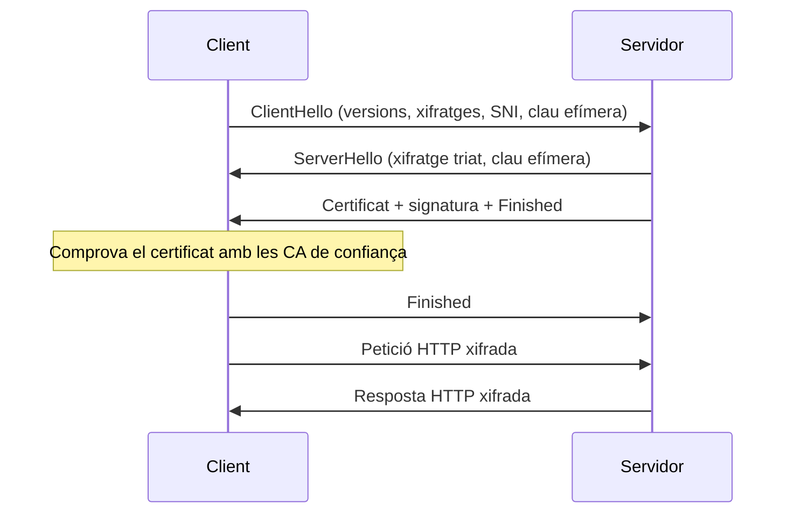
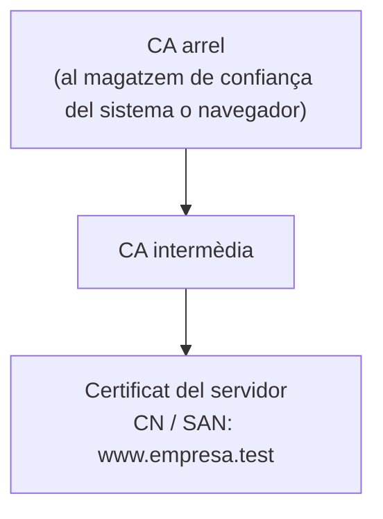
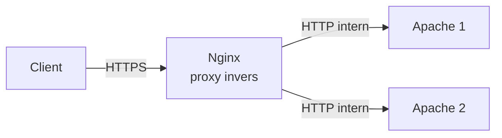

# Servidors web

## 1. Presentació

Un servidor web és el programari que rep peticions HTTP/HTTPS dels clients (navegadors, aplicacions, scripts) i hi respon amb recursos: pàgines, imatges, fitxers o dades generades per una aplicació. És el servei més exposat de qualsevol organització i, per tant, un dels que més cal saber **configurar, assegurar i vigilar**.

En aquest RA treballarem amb els dos servidors més utilitzats en entorns Linux: **Apache HTTP Server** i **Nginx**.

!!! info "Coneixements previs"

    Model TCP/IP, ús de la línia d'ordres a Linux, edició de fitxers de configuració i el funcionament del DNS ([RA1](../ra1/index.md)).

### Ruta del RA

| Pas | Material | Criteris d'avaluació |
| --- | --- | --- |
| 1 | Aquesta pàgina de teoria | 1 |
| 2 | [Pràctica 1: instal·lació d'Apache](02-practica-1-installacio-apache.md) | 1, 2 |
| 3 | [Pràctica 2: hosts virtuals](03-practica-2-hosts-virtuals.md) | 4 |
| 4 | [Pràctica 3: mòduls](04-practica-3-moduls.md) | 3 |
| 5 | [Pràctica 4: autenticació i control d'accés](05-practica-4-autenticacio.md) | 5 |
| 6 | [Pràctica 5: HTTPS i certificats](06-practica-5-https.md) | 6, 7 |
| 7 | [Pràctica 6: registres i monitoratge](07-practica-6-registres-monitoratge.md) | 8, 9 |
| 8 | [Pràctica 7: Nginx i proxy invers](08-practica-7-nginx-proxy-invers.md) | 2, 3, 7 |
| 9 | [Activitat final: desplegament segur](09-activitat-final.md) | 1–10 |

## 2. El protocol HTTP

### 2.1 Model client-servidor

HTTP (*HyperText Transfer Protocol*) és un protocol de capa d'aplicació basat en **petició i resposta**: el client sempre inicia la comunicació i el servidor respon. Per defecte fa servir el port **TCP 80** (HTTP) i **TCP 443** (HTTPS).

Un recurs s'identifica amb una **URL**:

```text
https://www.empresa.test:443/docs/manual.html?versio=2#instal·lacio
└─┬─┘   └──────┬───────┘└┬┘└───────┬───────┘└───┬────┘└─────┬─────┘
esquema      host      port      camí        consulta   fragment
```

El fragment (`#…`) no s'envia mai al servidor: el fa servir només el navegador.

### 2.2 Petició i resposta

=== "Petició"

    ```http
    GET /docs/manual.html HTTP/1.1
    Host: www.empresa.test
    User-Agent: curl/8.5.0
    Accept: */*
    ```

    - **Línia de petició**: mètode, camí i versió.
    - **Capçaleres**: informació addicional. `Host` és obligatòria des d'HTTP/1.1 i és la que permet els hosts virtuals per nom.
    - **Cos** (opcional): dades enviades, per exemple en un formulari amb `POST`.

=== "Resposta"

    ```http
    HTTP/1.1 200 OK
    Date: Thu, 22 Oct 2026 10:15:00 GMT
    Server: Apache
    Content-Type: text/html; charset=UTF-8
    Content-Length: 5120

    <!doctype html>
    <html> ...
    ```

    - **Línia d'estat**: versió, codi d'estat i frase.
    - **Capçaleres**: tipus de contingut, mida, galetes, polítiques de seguretat…
    - **Cos**: el recurs demanat.

Podeu veure una petició i la seva resposta completes amb:

```bash
curl -v http://www.empresa.test/
```

Les línies que comencen per `>` són la petició; les que comencen per `<`, la resposta.

### 2.3 Mètodes

| Mètode | Ús | Té cos? |
| --- | --- | --- |
| `GET` | Obtenir un recurs | No |
| `HEAD` | Com `GET`, però només les capçaleres | No |
| `POST` | Enviar dades (formularis, API) | Sí |
| `PUT` | Crear o substituir un recurs | Sí |
| `PATCH` | Modificar parcialment un recurs | Sí |
| `DELETE` | Esborrar un recurs | No |
| `OPTIONS` | Consultar quins mètodes admet el servidor | No |
| `TRACE` | Retorna la petició tal com arriba (diagnòstic) | No |

!!! warning "Seguretat"

    `TRACE` s'ha fet servir en atacs per robar galetes (*Cross-Site Tracing*). En producció s'ha de desactivar, i en general només s'haurien d'admetre els mètodes que l'aplicació necessita.

### 2.4 Codis d'estat

| Família | Significat | Exemples habituals |
| --- | --- | --- |
| **1xx** | Informació | 101 Switching Protocols |
| **2xx** | Èxit | 200 OK, 201 Created, 204 No Content |
| **3xx** | Redirecció | 301 Moved Permanently, 302 Found, 304 Not Modified |
| **4xx** | Error del client | 400 Bad Request, 401 Unauthorized, 403 Forbidden, 404 Not Found, 405 Method Not Allowed |
| **5xx** | Error del servidor | 500 Internal Server Error, 502 Bad Gateway, 503 Service Unavailable, 504 Gateway Timeout |

!!! tip "401 o 403?"

    **401** vol dir «no sé qui ets: identifica't» (el servidor demana credencials). **403** vol dir «sé qui ets (o no cal saber-ho), però no tens permís».

### 2.5 Sense estat: galetes i sessions

HTTP és un protocol **sense estat**: cada petició és independent i el servidor no recorda les anteriors. Per mantenir una sessió (per exemple, un usuari identificat) el servidor envia una **galeta** amb `Set-Cookie` i el navegador la retorna a cada petició amb `Cookie`.

Atributs de seguretat de les galetes: `Secure` (només per HTTPS), `HttpOnly` (no accessible des de JavaScript) i `SameSite` (limita l'enviament des d'altres llocs).

### 2.6 Versions d'HTTP

| Versió | Any | Novetats principals |
| --- | --- | --- |
| HTTP/1.0 | 1996 | Una connexió TCP per cada petició |
| HTTP/1.1 | 1997 | Connexions persistents (*keep-alive*), capçalera `Host` obligatòria, hosts virtuals |
| HTTP/2 | 2015 | Format binari, multiplexació de moltes peticions en una sola connexió, compressió de capçaleres |
| HTTP/3 | 2022 | Funciona sobre **QUIC** (UDP), menys latència i sense bloqueig de cap de línia |

## 3. HTTPS i TLS

### 3.1 Què aporta

HTTPS és HTTP dins d'una connexió **TLS** (*Transport Layer Security*). Aporta tres garanties:

- **Confidencialitat**: ningú que estigui a la ruta pot llegir el contingut.
- **Integritat**: ningú el pot modificar sense que es detecti.
- **Autenticació del servidor**: el certificat demostra que parlem amb el servidor legítim i no amb un impostor.

Avui només s'haurien d'acceptar **TLS 1.2** i **TLS 1.3**. SSL 2.0/3.0 i TLS 1.0/1.1 estan obsolets i són insegurs.

### 3.2 Negociació TLS 1.3 (simplificada)



- **SNI** (*Server Name Indication*): el client diu el nom del lloc a l'inici de la negociació. Així un mateix servidor amb una sola IP pot tenir un certificat diferent per a cada host virtual.
- Les claus de sessió es deriven d'un intercanvi **efímer** (Diffie-Hellman): encara que algun dia es filtri la clau privada del servidor, les sessions antigues no es poden desxifrar (*forward secrecy*).

### 3.3 Certificats i autoritats de certificació

Un certificat X.509 associa una **clau pública** a una identitat (el nom del servidor) i està signat per una **autoritat de certificació (CA)**.



El navegador confia en el certificat del servidor si pot construir la **cadena** fins a una CA arrel que ja té instal·lada, si el nom coincideix amb el camp **SAN** (*Subject Alternative Name*) i si el certificat no ha caducat ni està revocat.

| Tipus de certificat | Qui el signa | Ús |
| --- | --- | --- |
| **Autosignat** | El mateix servidor | Proves. El navegador mostra un avís perquè ningú en dona fe |
| **CA pròpia** | Una CA interna de l'organització | Intranets i laboratoris; cal instal·lar la CA als clients |
| **Let's Encrypt (ACME)** | CA pública gratuïta, emissió automàtica | Llocs públics; cal un domini real accessible des d'Internet |
| **Comercial (DV/OV/EV)** | CA pública de pagament | Validen el domini (DV), l'organització (OV) o fan una validació estesa (EV) |

### 3.4 HSTS

La capçalera `Strict-Transport-Security` indica al navegador que, durant un temps, **només** es connecti a aquell lloc per HTTPS. Evita els atacs que forcen el client a baixar a HTTP (*SSL stripping*).

!!! danger "Compte amb HSTS al laboratori"

    El navegador recorda la política durant tot el `max-age`. Si l'activeu amb un valor alt i després voleu tornar a HTTP, el navegador s'hi negarà. Al laboratori feu servir valors petits (per exemple, `max-age=300`).

## 4. Arquitectura del servidor web

### 4.1 Contingut estàtic i dinàmic

- **Estàtic**: el servidor envia fitxers tal com són al disc (HTML, CSS, imatges). És el que fan millor i més ràpid.
- **Dinàmic**: la resposta la genera un programa (PHP, Python, Node.js, Java…). El servidor web el pot executar ell mateix (un mòdul) o, més habitualment, passar la petició a un procés extern (PHP-FPM, un servidor d'aplicacions) i fer de **proxy invers**.

### 4.2 Apache i Nginx

=== "Apache"

    Apache gestiona les connexions amb **MPM** (*Multi-Processing Modules*):

    - **prefork**: un procés per connexió. Robust però consumeix molta memòria. Necessari amb mòduls no segurs amb fils (per exemple, el `mod_php` clàssic).
    - **worker**: processos amb diversos fils; cada fil atén una connexió.
    - **event**: com *worker*, però un fil dedicat gestiona les connexions *keep-alive* inactives. **És el que fa servir Ubuntu per defecte.**

    Punts forts: molts mòduls, configuració distribuïda amb `.htaccess`, molt documentat.

=== "Nginx"

    Nginx fa servir una **arquitectura d'esdeveniments asíncrona**: uns pocs processos *worker* gestionen milers de connexions simultànies sense crear un procés o un fil per a cadascuna.

    Punts forts: molt eficient amb contingut estàtic i moltes connexions, excel·lent com a **proxy invers**, balancejador de càrrega i terminador TLS.

| | Apache | Nginx |
| --- | --- | --- |
| Model | Processos/fils (MPM) | Esdeveniments asíncrons |
| Configuració per directori | Sí (`.htaccess`) | No (tot a la configuració central) |
| Contingut dinàmic | Mòduls interns o proxy | Sempre extern (FastCGI, proxy) |
| Ús típic | Servidor d'aplicacions, hosting compartit | Proxy invers, contingut estàtic, alta concurrència |

En moltes instal·lacions reals es combinen: **Nginx al davant** (TLS, contingut estàtic, protecció) i **Apache al darrere** (aplicació).

## 5. Apache a Ubuntu

### 5.1 Fitxers i directoris

| Ruta | Contingut |
| --- | --- |
| `/etc/apache2/apache2.conf` | Configuració principal |
| `/etc/apache2/ports.conf` | Ports on escolta (`Listen 80`, `Listen 443`) |
| `/etc/apache2/sites-available/` | Definicions dels hosts virtuals |
| `/etc/apache2/sites-enabled/` | Enllaços als llocs actius |
| `/etc/apache2/mods-available/` i `mods-enabled/` | Mòduls disponibles i actius |
| `/etc/apache2/conf-available/` i `conf-enabled/` | Fragments de configuració global (p. ex. `security.conf`) |
| `/var/www/html/` | Arrel de documents del lloc per defecte |
| `/var/log/apache2/` | Registres `access.log` i `error.log` |

!!! note "Debian i Ubuntu"

    L'organització en `*-available` / `*-enabled` és pròpia de Debian i Ubuntu. En altres distribucions (Red Hat, Fedora) Apache s'anomena `httpd` i la configuració és a `/etc/httpd/`.

### 5.2 Eines

| Ordre | Funció |
| --- | --- |
| `a2ensite` / `a2dissite` | Activa / desactiva un lloc |
| `a2enmod` / `a2dismod` | Activa / desactiva un mòdul |
| `a2enconf` / `a2disconf` | Activa / desactiva un fragment de configuració |
| `apache2ctl configtest` | Comprova la sintaxi de la configuració |
| `apache2ctl -S` | Mostra els hosts virtuals i com s'han interpretat |
| `apache2ctl -M` | Llista els mòduls carregats |
| `systemctl reload apache2` | Aplica els canvis sense tallar les connexions |

!!! tip "Bona pràctica"

    Abans de cada `reload`, executeu sempre `apache2ctl configtest`. Si hi ha un error de sintaxi i reinicieu, el servei no tornarà a arrencar.

### 5.3 Directives bàsiques

```apache
<VirtualHost *:80>
    ServerName www.empresa.test
    ServerAlias empresa.test
    DocumentRoot /var/www/empresa

    <Directory /var/www/empresa>
        Options -Indexes +FollowSymLinks
        AllowOverride None
        Require all granted
    </Directory>

    ErrorLog ${APACHE_LOG_DIR}/empresa_error.log
    CustomLog ${APACHE_LOG_DIR}/empresa_access.log combined
</VirtualHost>
```

| Directiva | Significat |
| --- | --- |
| `ServerName` / `ServerAlias` | Nom (i àlies) que atén aquest host virtual |
| `DocumentRoot` | Directori arrel dels fitxers del lloc |
| `<Directory>` | Configuració aplicable a un directori i els seus subdirectoris |
| `Options -Indexes` | Desactiva el llistat automàtic del contingut d'un directori sense `index.html` |
| `AllowOverride` | Quines directives es poden canviar amb fitxers `.htaccess` (`None`, `All` o una llista) |
| `Require` | Qui hi pot accedir (vegeu la [secció 9](#9-autenticacio-i-control-dacces)) |
| `ErrorLog` / `CustomLog` | On es desen els registres d'errors i d'accessos |

## 6. Nginx a Ubuntu

| Ruta | Contingut |
| --- | --- |
| `/etc/nginx/nginx.conf` | Configuració principal |
| `/etc/nginx/sites-available/` i `sites-enabled/` | Blocs `server` (equivalents als hosts virtuals) |
| `/etc/nginx/conf.d/` | Fragments addicionals |
| `/var/www/html/` | Arrel per defecte |
| `/var/log/nginx/` | `access.log` i `error.log` |

La configuració s'organitza en **contextos** niats: `http` → `server` → `location`.

```nginx
server {
    listen 80;
    server_name www.empresa.test;
    root /var/www/empresa;
    index index.html;

    location / {
        try_files $uri $uri/ =404;
    }

    access_log /var/log/nginx/empresa_access.log;
    error_log  /var/log/nginx/empresa_error.log;
}
```

Nginx no té ordres `a2…`: un lloc s'activa creant un enllaç simbòlic a `sites-enabled/`. La sintaxi es comprova amb `nginx -t`.

**Equivalències**

| Apache | Nginx |
| --- | --- |
| `<VirtualHost>` | `server { }` |
| `ServerName` | `server_name` |
| `DocumentRoot` | `root` |
| `<Directory>` / `<Location>` | `location { }` |
| `Options -Indexes` | `autoindex off;` (per defecte) |
| `ServerTokens Prod` | `server_tokens off;` |
| `apache2ctl configtest` | `nginx -t` |

## 7. Hosts virtuals

Un sol servidor pot servir molts llocs web diferents. Hi ha tres maneres de distingir-los:

| Tipus | Com es distingeixen | Ús |
| --- | --- | --- |
| **Per nom** | Per la capçalera `Host` (i el SNI en HTTPS) | El més habitual: molts llocs amb una sola IP |
| **Per IP** | Cada lloc escolta en una IP diferent del servidor | Casos especials; consumeix adreces |
| **Per port** | Cada lloc en un port diferent (80, 8080…) | Serveis interns, administració, proves |

Quan arriba una petició, Apache tria el host virtual que coincideix amb la IP i el port i, d'entre aquests, el que té el `ServerName` o `ServerAlias` igual que la capçalera `Host`. **Si cap no coincideix, respon el primer que ha carregat** (el lloc per defecte). Per això convé que el lloc per defecte no mostri res sensible.

Perquè un host virtual per nom funcioni, el client ha de resoldre el nom cap a la IP del servidor: amb el DNS (el que vau muntar al RA1) o, al laboratori, amb el fitxer `/etc/hosts` del client.

## 8. Mòduls

La major part de la funcionalitat d'Apache està en mòduls que s'activen o desactiven segons calgui. Activar només els necessaris redueix la superfície d'atac i el consum de memòria.

| Mòdul | Funció |
| --- | --- |
| `mod_ssl` | HTTPS / TLS |
| `mod_rewrite` | Reescriptura i redirecció d'URL amb expressions regulars |
| `mod_headers` | Afegir, modificar o eliminar capçaleres HTTP |
| `mod_userdir` | Pàgines personals dels usuaris (`/~usuari/`) |
| `mod_status` | Pàgina d'estat del servidor en temps real |
| `mod_auth_basic`, `mod_auth_digest` | Autenticació HTTP |
| `mod_authz_core`, `mod_authz_host` | Control d'accés (`Require`) |
| `mod_proxy`, `mod_proxy_http`, `mod_proxy_fcgi` | Proxy cap a altres servidors o cap a PHP-FPM |
| `mod_remoteip` | Registrar la IP real del client quan hi ha un proxy al davant |
| `mod_deflate` | Compressió de les respostes |
| `mod_security2` | Tallafocs d'aplicacions web (WAF) |

## 9. Autenticació i control d'accés

### 9.1 Autenticació HTTP

| Mètode | Com viatgen les credencials | Comentari |
| --- | --- | --- |
| **Basic** | Usuari i contrasenya codificats en **Base64** (no xifrats!) a cada petició | Només és acceptable **sobre HTTPS** |
| **Digest** | Un *hash* de la contrasenya amb un valor aleatori del servidor | Millor que Basic en clar, però amb algorismes antics (MD5); avui es prefereix Basic sobre HTTPS |
| **Formulari + sessió** | L'aplicació gestiona l'inici de sessió | El més habitual en aplicacions web |
| **Certificat de client** | El client presenta un certificat TLS | Molt segur; requereix gestionar certificats |

Les contrasenyes d'Apache es desen en fitxers creats amb `htpasswd` (Basic) o `htdigest` (Digest). **Aquests fitxers mai no han d'estar dins del `DocumentRoot`.**

### 9.2 Control d'accés amb `Require`

| Directiva | Qui hi pot accedir |
| --- | --- |
| `Require all granted` | Tothom |
| `Require all denied` | Ningú |
| `Require ip 192.168.56.0/24` | Una adreça o una xarxa |
| `Require host empresa.test` | Equips d'un domini (fa una consulta DNS inversa) |
| `Require valid-user` | Qualsevol usuari autenticat |
| `Require user anna joan` | Usuaris concrets |
| `Require group administradors` | Els membres d'un grup (`mod_authz_groupfile`) |

Es poden combinar amb `<RequireAll>` (s'han de complir totes) i `<RequireAny>` (n'hi ha prou amb una):

```apache
<RequireAll>
    Require ip 192.168.56.0/24
    Require valid-user
</RequireAll>
```

### 9.3 Fitxers `.htaccess`

Permeten canviar la configuració d'un directori sense tocar la configuració principal ni reiniciar el servei, si `AllowOverride` ho permet. Són útils en hosting compartit, però:

- Apache els busca a **cada petició** i en cada directori del camí, cosa que penalitza el rendiment.
- Reparteixen la configuració i en dificulten l'auditoria.

Quan es té accés a la configuració del servidor, és preferible posar-ho tot en un bloc `<Directory>` i deixar `AllowOverride None`.

## 10. Registres

### 10.1 Registre d'accessos

Apache fa servir per defecte el format **combined**:

```text
192.168.56.20 - anna [22/Oct/2026:10:15:00 +0200] "GET /privat/ HTTP/1.1" 200 5120 "-" "curl/8.5.0"
```

| Camp | Valor de l'exemple | Directiva `LogFormat` |
| --- | --- | --- |
| IP del client | `192.168.56.20` | `%h` |
| Usuari autenticat | `anna` | `%u` |
| Data i hora | `[22/Oct/2026:10:15:00 +0200]` | `%t` |
| Línia de petició | `"GET /privat/ HTTP/1.1"` | `%r` |
| Codi d'estat | `200` | `%>s` |
| Bytes enviats (amb capçaleres) | `5120` | `%O` (`%b` només compta el cos) |
| Pàgina d'origen | `"-"` | `%{Referer}i` |
| Client | `"curl/8.5.0"` | `%{User-Agent}i` |

Amb `LogFormat` es poden definir formats propis, per exemple afegint el temps de resposta en microsegons (`%D`).

### 10.2 Registre d'errors

Recull errors de configuració, fitxers no trobats, accessos denegats, fallades de mòduls… El detall es controla amb `LogLevel` (`emerg`, `alert`, `crit`, `error`, `warn`, `notice`, `info`, `debug`, i `trace1` a `trace8`).

### 10.3 Rotació

Els registres creixen sense parar. A Ubuntu, **logrotate** els rota cada dia o setmana, els comprimeix i esborra els antics (`/etc/logrotate.d/apache2` i `/etc/logrotate.d/nginx`).

!!! warning "Protecció de dades"

    Els registres contenen adreces IP i, de vegades, noms d'usuari: són **dades personals**. Cal limitar-ne l'accés i definir quant de temps es conserven.

## 11. Monitoratge

- **Estat del servei**: `systemctl status apache2`, `journalctl -u apache2`.
- **Estat intern**: `mod_status` a Apache (`/server-status`) i `stub_status` a Nginx mostren connexions actives, peticions per segon i estat dels treballadors. **Han d'estar restringits** a la xarxa d'administració.
- **Proves de càrrega**: `ab` (*Apache Bench*) o `wrk` simulen molts clients per veure com respon el servidor.
- **Seguiment en directe dels registres**: `tail -f`, `goaccess`.
- **Monitoratge continu**: eines com Zabbix, Nagios, Prometheus o Uptime Kuma comproven periòdicament que el lloc respon i avisen si cau.

## 12. Proxy invers i balanceig

Un **proxy invers** rep les peticions dels clients i les reenvia a un o més servidors interns (*backends*). Per al client, el proxy és el servidor.



Avantatges:

- **Terminació TLS**: els certificats només es gestionen al proxy.
- **Balanceig de càrrega** entre diversos backends i alta disponibilitat.
- **Protecció**: els backends no són accessibles directament des de l'exterior; el proxy pot filtrar peticions, limitar-ne la freqüència o fer de WAF.
- **Memòria cau** del contingut estàtic.

Com que el backend rep la connexió del proxy, veuria sempre la IP del proxy. Per saber la IP real del client, el proxy afegeix la capçalera `X-Forwarded-For` (o `X-Real-IP`) i el backend la interpreta amb `mod_remoteip`, confiant-hi **només** si la petició ve del proxy.

## 13. Bastionat d'un servidor web

!!! abstract "Llista de comprovació"

    - [ ] Sistema i servidor web **actualitzats**.
    - [ ] Només els **mòduls** necessaris activats.
    - [ ] No revelar versions: `ServerTokens Prod`, `ServerSignature Off` (Apache) o `server_tokens off` (Nginx).
    - [ ] `TraceEnable Off` i només els mètodes HTTP necessaris.
    - [ ] Sense llistat de directoris (`Options -Indexes`).
    - [ ] Lloc per defecte que no mostri contingut real.
    - [ ] HTTPS obligatori amb TLS 1.2/1.3 i redirecció des d'HTTP.
    - [ ] Capçaleres de seguretat: `Strict-Transport-Security`, `X-Content-Type-Options: nosniff`, `X-Frame-Options` o `Content-Security-Policy: frame-ancestors`, `Referrer-Policy`.
    - [ ] Fitxers de contrasenyes, claus privades i còpies de seguretat **fora del `DocumentRoot`**.
    - [ ] Permisos mínims: els fitxers del lloc no han de ser modificables per l'usuari del servidor (`www-data`) si no cal.
    - [ ] Pàgines d'estat i d'administració restringides per IP i autenticació.
    - [ ] Registres activats, rotats i revisats.
    - [ ] Tallafocs que només deixi passar els ports 80 i 443 (i l'administració des de la xarxa interna).
    - [ ] Protecció contra força bruta i abusos: `fail2ban`, limitació de peticions, WAF (ModSecurity amb les regles OWASP CRS).

Eines per comprovar-ho: `nmap --script http-headers,http-methods`, `nikto`, `testssl.sh`, l'observatori de Mozilla o SSL Labs (aquests dos últims, només per a llocs públics).

!!! danger "Ètica i legalitat"

    Les eines d'escaneig només es poden fer servir contra servidors propis o del laboratori, o amb autorització expressa.
