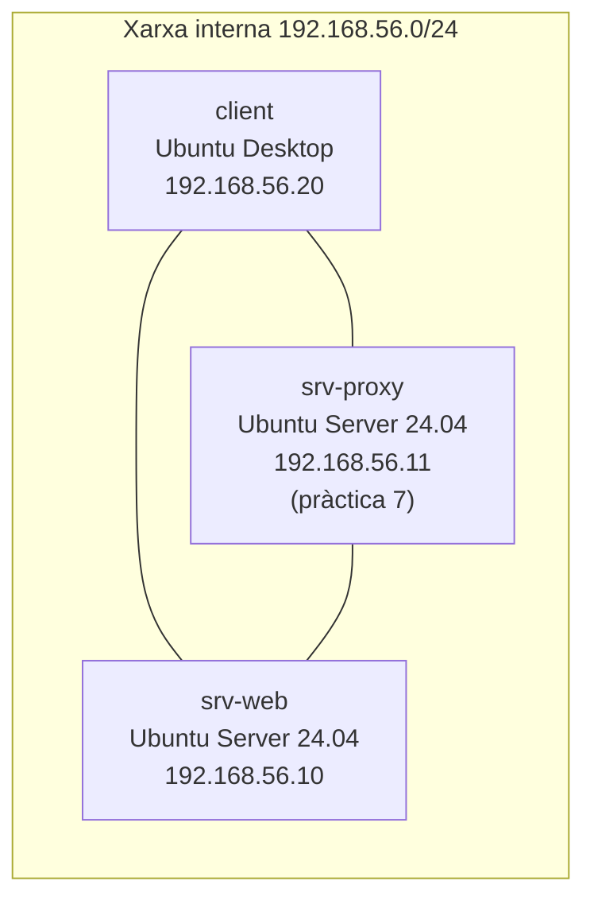

# Pràctica 1: instal·lació d'Apache i primeres proves

!!! abstract "Objectius"

    - Muntar l'escenari de laboratori que farem servir en totes les pràctiques del RA.
    - Instal·lar i posar en marxa Apache a Ubuntu Server.
    - Identificar els fitxers de configuració, l'arrel de documents i els registres.
    - Observar peticions i respostes HTTP reals.

    **Criteris d'avaluació:** 1, 2 · **Durada orientativa:** 2 h

## Escenari del laboratori



| Màquina | Sistema | Adreça | Ús |
| --- | --- | --- | --- |
| `srv-web` | Ubuntu Server 24.04 LTS | 192.168.56.10/24 | Servidor Apache (totes les pràctiques) |
| `client` | Ubuntu Desktop 24.04 LTS | 192.168.56.20/24 | Navegador, `curl` i eines de prova |
| `srv-proxy` | Ubuntu Server 24.04 LTS | 192.168.56.11/24 | Nginx (només a la pràctica 7) |

Cada màquina té dos adaptadors: un en **NAT** (per a Internet i actualitzacions) i un en **xarxa interna / només amfitrió** amb les adreces de la taula. El domini del laboratori és **`empresa.test`** (el domini `.test` està reservat per a proves i no existeix a Internet).

??? example "Configuració de xarxa amb Netplan (`srv-web`)"

    Comproveu el nom de les interfícies amb `ip -br a` i adapteu-lo (aquí `enp0s3` és la NAT i `enp0s8`, la interna).

    ```yaml title="/etc/netplan/50-laboratori.yaml"
    network:
      version: 2
      ethernets:
        enp0s3:
          dhcp4: true
        enp0s8:
          addresses: [192.168.56.10/24]
    ```

    ```bash
    sudo chmod 600 /etc/netplan/50-laboratori.yaml
    sudo netplan apply
    ip -br a
    ```

## Pas 1. Instal·lar Apache

A `srv-web`:

```bash
sudo apt update
sudo apt install -y apache2 apache2-utils
```

Comproveu que el servei està actiu i habilitat a l'arrencada:

```bash
systemctl status apache2
systemctl is-enabled apache2
```

Si el tallafocs UFW està actiu, obriu els ports web:

```bash
sudo ufw allow 'Apache Full'      # obre 80 i 443
sudo ufw status
```

## Pas 2. Comprovar que escolta

```bash
sudo ss -tlnp | grep apache2
apache2 -v
```

!!! question "Anoteu"

    En quin port i en quines adreces escolta Apache? Quina versió s'ha instal·lat?

Des del `client`, obriu el navegador a `http://192.168.56.10`. Ha d'aparèixer la pàgina per defecte d'Ubuntu.

## Pas 3. Explorar l'estructura

```bash
ls -l /etc/apache2/
ls -l /etc/apache2/sites-available/ /etc/apache2/sites-enabled/
ls /etc/apache2/mods-enabled/ | grep '\.load$'
cat /etc/apache2/ports.conf
cat /etc/apache2/sites-available/000-default.conf
ls -l /var/www/html/ /var/log/apache2/
```

Completeu la taula al vostre informe:

| Element | Ruta o valor |
| --- | --- |
| Fitxer de configuració principal | |
| Fitxer on es defineixen els ports | |
| Lloc actiu per defecte | |
| Arrel de documents del lloc per defecte | |
| Fitxer de registre d'accessos | |
| Fitxer de registre d'errors | |
| Usuari amb què s'executa Apache (busqueu `APACHE_RUN_USER` a `/etc/apache2/envvars`) | |
| MPM actiu (`apache2ctl -M \| grep mpm`) | |

## Pas 4. Primera pàgina pròpia

Substituïu la pàgina per defecte:

```bash
sudo mv /var/www/html/index.html /var/www/html/index.html.original
echo '<!doctype html><html lang="ca"><head><meta charset="utf-8"><title>srv-web</title></head><body><h1>Servidor web de nom-cognom</h1></body></html>' \
  | sudo tee /var/www/html/index.html
```

Recarregueu el navegador del client.

## Pas 5. Observar HTTP amb `curl`

Al `client` (instal·leu-lo amb `sudo apt install curl` si cal):

```bash
curl -v http://192.168.56.10/
curl -I http://192.168.56.10/            # només capçaleres (petició HEAD)
curl -I http://192.168.56.10/no-existeix
curl -X OPTIONS -i http://192.168.56.10/
```

Mireu també, al servidor, què ha quedat registrat:

```bash
sudo tail -n 5 /var/log/apache2/access.log
sudo tail -n 5 /var/log/apache2/error.log
```

## Pas 6. Gestió del servei

```bash
sudo apache2ctl configtest
sudo systemctl reload apache2
sudo systemctl restart apache2
```

??? note "Avís AH00558: *Could not reliably determine the server's fully qualified domain name*"

    No és un error: Apache avisa que no té cap nom de servidor global. Per eliminar-lo:

    ```bash
    echo "ServerName srv-web.empresa.test" | sudo tee /etc/apache2/conf-available/servername.conf
    sudo a2enconf servername
    sudo apache2ctl configtest
    ```

Provoqueu un error de sintaxi expressament (per exemple, escriviu `Listen80` a `ports.conf`), executeu `apache2ctl configtest` i observeu el missatge. **Torneu a deixar el fitxer bé** abans de continuar.

## Preguntes

1. Quina diferència hi ha entre `reload` i `restart`? Quan faríeu servir cadascun en un servidor en producció?
2. A la sortida de `curl -v`, quines línies corresponen a la petició i quines a la resposta? Quina capçalera de la petició és imprescindible en HTTP/1.1 i per què?
3. Quin codi d'estat obteniu per a `/no-existeix`? A quina família pertany i què indica?
4. Quina informació revela la capçalera `Server` de la resposta? Per què pot ser un problema de seguretat?
5. Per què és important que el servidor s'executi amb l'usuari `www-data` i no amb `root`?

## Lliurament

Informe en PDF amb la taula del pas 3, captures dels passos 2, 4 i 5 i les respostes a les preguntes.
