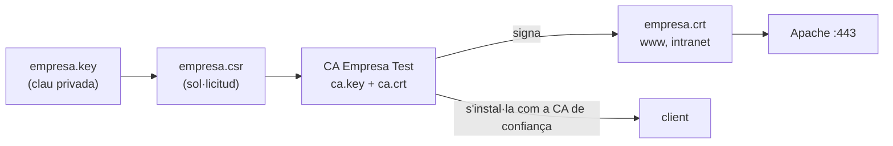

# Pràctica 5: HTTPS amb una autoritat de certificació pròpia

!!! abstract "Objectius"

    - Crear una autoritat de certificació (CA) per al laboratori.
    - Generar una sol·licitud de certificat, signar-la i instal·lar el certificat a Apache.
    - Fer que la CA sigui de confiança als clients.
    - Forçar HTTPS, limitar les versions de TLS i afegir HSTS.
    - Verificar que la comunicació queda protegida.

    **Criteris d'avaluació:** 6, 7 · **Durada orientativa:** 3 h · **Prerequisits:** [pràctiques 2](03-practica-2-hosts-virtuals.md) i [4](05-practica-4-autenticacio.md)



!!! note "Per què una CA pròpia i no un certificat autosignat?"

    Amb un certificat autosignat, cada lloc és la seva pròpia CA i cal acceptar una excepció a cada navegador i per a cada lloc. Amb una CA interna, s'instal·la **una sola vegada** la CA als clients i tots els certificats que emeti seran de confiança. És el que fan moltes organitzacions per als serveis interns.

## Pas 1. Crear la CA

A `srv-web` (en un entorn real, la CA estaria en una màquina separada i protegida):

```bash
sudo mkdir -p /root/ca && cd /root/ca
sudo openssl genrsa -out ca.key 4096
sudo chmod 600 ca.key
sudo openssl req -x509 -new -key ca.key -sha256 -days 3650 \
  -subj "/C=ES/O=Empresa Test/CN=CA Empresa Test" \
  -out ca.crt
sudo openssl x509 -in ca.crt -noout -subject -issuer -dates
```

!!! question "Observeu"

    En el certificat de la CA, el *subject* i l'*issuer* coincideixen. Per què?

## Pas 2. Clau i sol·licitud del servidor

```bash
cd /root/ca
sudo openssl req -new -newkey rsa:2048 -nodes \
  -keyout empresa.key -out empresa.csr \
  -subj "/C=ES/O=Empresa Test/CN=www.empresa.test"
```

El certificat ha de ser vàlid per a tots els noms dels llocs. Això es defineix amb l'extensió **SAN**:

```ini title="/root/ca/empresa.ext"
basicConstraints = CA:FALSE
keyUsage = digitalSignature, keyEncipherment
extendedKeyUsage = serverAuth
subjectAltName = DNS:www.empresa.test, DNS:empresa.test, DNS:intranet.empresa.test
```

## Pas 3. Signar el certificat amb la CA

```bash
sudo openssl x509 -req -in empresa.csr \
  -CA ca.crt -CAkey ca.key -CAcreateserial \
  -days 365 -sha256 -extfile empresa.ext \
  -out empresa.crt
sudo openssl x509 -in empresa.crt -noout -text | grep -A1 -E "Issuer|Subject:|Not After|Alternative"
sudo openssl verify -CAfile ca.crt empresa.crt
```

Instal·leu el certificat i la clau on els trobarà Apache:

```bash
sudo cp empresa.crt /etc/ssl/certs/empresa.crt
sudo cp empresa.key /etc/ssl/private/empresa.key
sudo chown root:root /etc/ssl/private/empresa.key
sudo chmod 600 /etc/ssl/private/empresa.key
```

## Pas 4. Configurar HTTPS a Apache

```bash
sudo a2enmod ssl headers
```

Limiteu les versions de TLS per a tot el servidor a `/etc/apache2/mods-available/ssl.conf`:

```apache
SSLProtocol -all +TLSv1.2 +TLSv1.3
```

Reorganitzeu `empresa.conf`: el port 80 només redirigeix i tot el contingut es serveix pel 443.

```apache title="/etc/apache2/sites-available/empresa.conf"
<VirtualHost *:80>
    ServerName www.empresa.test
    ServerAlias empresa.test
    Redirect permanent / https://www.empresa.test/
</VirtualHost>

<VirtualHost *:443>
    ServerName www.empresa.test
    ServerAlias empresa.test
    DocumentRoot /var/www/empresa

    SSLEngine on
    SSLCertificateFile    /etc/ssl/certs/empresa.crt
    SSLCertificateKeyFile /etc/ssl/private/empresa.key

    # HSTS amb un valor curt per al laboratori (en producció: 31536000)
    Header always set Strict-Transport-Security "max-age=300"
    Header always set X-Content-Type-Options "nosniff"
    Header always set X-Frame-Options "SAMEORIGIN"
    Header always set Referrer-Policy "strict-origin-when-cross-origin"

    RewriteEngine On
    RewriteCond %{HTTP_HOST} ^empresa\.test$ [NC]
    RewriteRule ^/(.*)$ https://www.empresa.test/$1 [R=301,L]
    RewriteRule ^/noticies/?(.*)$ /actualitat/$1 [R=301,L]

    <Directory /var/www/empresa>
        Options -Indexes
        AllowOverride None
        Require all granted
    </Directory>

    ErrorLog ${APACHE_LOG_DIR}/empresa_error.log
    CustomLog ${APACHE_LOG_DIR}/empresa_access.log combined
</VirtualHost>
```

```bash
sudo apache2ctl configtest && sudo systemctl reload apache2
sudo ss -tlnp | grep ':443'
```

Feu el mateix amb `intranet.conf`: redirecció al port 80 i tota la configuració d'autenticació de la pràctica 4 dins del `<VirtualHost *:443>`.

## Pas 5. Primera prova: el client encara no confia en la CA

Des del client:

```bash
curl -I https://www.empresa.test/
```

Obtindreu un error de verificació del certificat. Proveu-ho també amb el navegador i mireu els detalls de l'avís.

Copieu el certificat de la CA al client. És un fitxer **públic**; el que mai no ha de sortir del servidor és `ca.key`.

```bash
sudo install -m 644 /root/ca/ca.crt /tmp/ca.crt        # al servidor
scp usuari@192.168.56.10:/tmp/ca.crt .                 # al client
curl -I --cacert ca.crt https://www.empresa.test/      # al client: ara sí que funciona
```

## Pas 6. Confiar en la CA al client

=== "Sistema (curl, wget…)"

    ```bash
    sudo cp ca.crt /usr/local/share/ca-certificates/empresa-test-ca.crt
    sudo update-ca-certificates
    curl -I https://www.empresa.test/
    ```

=== "Firefox"

    Firefox fa servir el seu propi magatzem de certificats:

    **Configuració → Privadesa i seguretat → Certificats → Mostra els certificats → Autoritats → Importa** i marqueu *Confia en aquesta CA per identificar llocs web*.

=== "Chrome / Chromium"

    **Configuració → Privadesa i seguretat → Seguretat → Gestiona els certificats → Autoritats → Importa**.

Torneu a obrir `https://www.empresa.test` i `https://intranet.empresa.test`: ara el cadenat ha d'aparèixer sense avisos. Mireu els detalls del certificat al navegador.

## Pas 7. Verificacions

Redirecció i capçaleres:

```bash
curl -I http://www.empresa.test/
curl -I https://www.empresa.test/
```

Negociació TLS i cadena de certificats:

```bash
openssl s_client -connect www.empresa.test:443 -servername www.empresa.test </dev/null | head -20
```

Versions de TLS (la primera ha de fallar):

```bash
curl -I --tlsv1.1 --tls-max 1.1 https://www.empresa.test/
curl -I --tlsv1.2 --tls-max 1.2 https://www.empresa.test/
curl -I --tlsv1.3 https://www.empresa.test/
```

Inventari de versions i xifratges acceptats:

```bash
sudo apt install -y nmap
nmap --script ssl-enum-ciphers -p 443 www.empresa.test
```

## Pas 8. Tornem a capturar les credencials

Repetiu el pas 6 de la [pràctica 4](05-practica-4-autenticacio.md), ara contra HTTPS:

```bash
sudo tcpdump -l -i any -A -n 'tcp port 443' | grep -i "authorization"    # al servidor
curl -u anna https://intranet.empresa.test/                                # al client
```

Captureu també el trànsit amb Wireshark al client i compareu una petició pel port 80 amb una pel 443.

## Ampliació: Let's Encrypt

Si disposeu d'un domini real apuntant a un servidor accessible des d'Internet, `certbot` obté i renova automàticament certificats gratuïts:

```bash
sudo apt install -y certbot python3-certbot-apache
sudo certbot --apache -d www.el-vostre-domini.cat --staging    # --staging per a proves
```

Investigueu: com demostra `certbot` que controleu el domini (repte HTTP-01)? Cada quant cal renovar el certificat i com s'automatitza?

## Preguntes

1. Quins fitxers d'aquesta pràctica són públics i quins s'han de protegir? Què passaria si algú obtingués `ca.key`? I `empresa.key`?
2. Per què el certificat del servidor ha d'incloure els noms al camp SAN i no només al CN?
3. Quin paper té l'extensió SNI quan diversos llocs HTTPS comparteixen la mateixa IP?
4. Per què hem configurat HSTS amb `max-age=300` i no amb un any? Quin risc té fer-ho al laboratori?
5. Quina diferència heu vist a les captures del pas 8 respecte de la pràctica 4?
6. Quina és la diferència entre un certificat autosignat, un d'una CA interna i un de Let's Encrypt? Quan faríeu servir cadascun?

## Lliurament

Configuracions `empresa.conf` i `intranet.conf`, la sortida d'`openssl x509 -text` del certificat del servidor, captures dels passos 5 a 8 i respostes a les preguntes.
