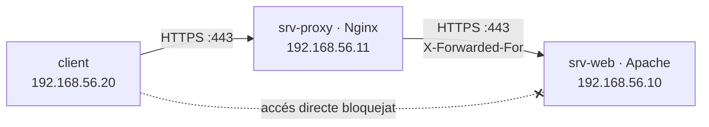

# Pràctica 7: Nginx com a servidor web i com a proxy invers

!!! abstract "Objectius"

    - Instal·lar i configurar Nginx i comparar-ne la configuració amb la d'Apache.
    - Posar Nginx com a **proxy invers** amb terminació TLS davant del servidor Apache.
    - Conservar la IP real dels clients als registres d'Apache amb `mod_remoteip`.
    - Impedir l'accés directe al servidor intern.

    **Criteris d'avaluació:** 2, 3, 7 · **Durada orientativa:** 3 h · **Prerequisits:** [pràctiques 5](06-practica-5-https.md) i [6](07-practica-6-registres-monitoratge.md)



Prepareu la màquina `srv-proxy` (Ubuntu Server 24.04, 192.168.56.11) igual que vau fer amb `srv-web` a la [pràctica 1](02-practica-1-installacio-apache.md#escenari-del-laboratori).

## Part A. Nginx com a servidor web

### Pas 1. Instal·lació

```bash
sudo apt update
sudo apt install -y nginx
systemctl status nginx
sudo ss -tlnp | grep nginx
nginx -v
ls /etc/nginx/ /etc/nginx/sites-available/ /etc/nginx/sites-enabled/
```

Obriu `http://192.168.56.11` des del client.

### Pas 2. Un bloc `server` propi

```bash
sudo mkdir -p /var/www/estatic
echo "<h1>Servit per Nginx</h1>" | sudo tee /var/www/estatic/index.html
```

```nginx title="/etc/nginx/sites-available/estatic"
server {
    listen 80;
    server_name estatic.empresa.test;
    root /var/www/estatic;
    index index.html;

    location / {
        try_files $uri $uri/ =404;
    }

    location = /nginx-status {
        stub_status;
        allow 192.168.56.20;
        deny all;
    }

    access_log /var/log/nginx/estatic_access.log;
    error_log  /var/log/nginx/estatic_error.log;
}
```

```bash
sudo ln -s /etc/nginx/sites-available/estatic /etc/nginx/sites-enabled/
sudo nginx -t && sudo systemctl reload nginx
```

Afegiu `192.168.56.11 estatic.empresa.test` al `/etc/hosts` del client i proveu `http://estatic.empresa.test/` i `http://estatic.empresa.test/nginx-status`.

### Pas 3. Bastionat bàsic

A `/etc/nginx/nginx.conf`, dins del bloc `http`, descomenteu o afegiu `server_tokens off;`. Compareu la capçalera `Server` abans i després:

```bash
curl -I http://estatic.empresa.test/
```

### Pas 4. Comparativa

Completeu la taula al vostre informe a partir del que heu fet amb tots dos servidors:

| Tasca | Apache | Nginx |
| --- | --- | --- |
| Comprovar la sintaxi | | |
| Activar un lloc | | |
| Definir el nom del lloc | | |
| Arrel de documents | | |
| Ocultar la versió | | |
| Pàgina d'estat | | |
| Configuració per directori (`.htaccess`) | | |
| Nombre de processos en repòs (`ps -C apache2` / `ps -C nginx`) | | |
| Memòria en repòs (`systemctl status`) | | |

## Part B. Nginx com a proxy invers

### Pas 5. Certificats al proxy

El proxy serà qui presenti el certificat als clients. Copieu de `srv-web` el certificat i la clau del servidor, i també el certificat de la CA (el farem servir per verificar el backend):

```bash
sudo mkdir -p /etc/nginx/ssl
# Copieu-hi empresa.crt, empresa.key i ca.crt (per exemple amb scp a través de /tmp)
sudo chown root:root /etc/nginx/ssl/*
sudo chmod 600 /etc/nginx/ssl/empresa.key
```

### Pas 6. Configuració del proxy

```nginx title="/etc/nginx/sites-available/empresa-proxy"
server {
    listen 80;
    server_name www.empresa.test empresa.test;
    return 301 https://www.empresa.test$request_uri;
}

server {
    listen 443 ssl http2;
    server_name www.empresa.test empresa.test;

    ssl_certificate     /etc/nginx/ssl/empresa.crt;
    ssl_certificate_key /etc/nginx/ssl/empresa.key;
    ssl_protocols TLSv1.2 TLSv1.3;

    access_log /var/log/nginx/empresa_proxy_access.log;
    error_log  /var/log/nginx/empresa_proxy_error.log;

    location / {
        proxy_pass https://192.168.56.10;

        # Informació del client original per al backend
        proxy_set_header Host              $host;
        proxy_set_header X-Real-IP         $remote_addr;
        proxy_set_header X-Forwarded-For   $proxy_add_x_forwarded_for;
        proxy_set_header X-Forwarded-Proto $scheme;

        # La connexió amb Apache també va xifrada i es verifica el seu certificat
        proxy_ssl_server_name on;
        proxy_ssl_name $host;
        proxy_ssl_verify on;
        proxy_ssl_trusted_certificate /etc/nginx/ssl/ca.crt;
    }
}
```

```bash
sudo ln -s /etc/nginx/sites-available/empresa-proxy /etc/nginx/sites-enabled/
sudo nginx -t && sudo systemctl reload nginx
```

Al client, feu que `www.empresa.test` i `empresa.test` apuntin ara al proxy (`192.168.56.11`) al `/etc/hosts` o al DNS. Proveu el lloc amb el navegador i amb `curl -I https://www.empresa.test/`.

### Pas 7. La IP real del client a Apache

Mireu el registre d'accessos d'Apache a `srv-web`:

```bash
sudo tail -n 3 /var/log/apache2/empresa_access.log
```

!!! question "Observeu"

    Quina IP hi apareix? I què passa ara amb la restricció `Require ip 192.168.56.20` de `/server-status` (pràctica 6)?

A `srv-web`, activeu `mod_remoteip` i indiqueu en quin proxy es confia:

```apache title="/etc/apache2/conf-available/remoteip.conf"
RemoteIPHeader X-Forwarded-For
RemoteIPTrustedProxy 192.168.56.11
```

```bash
sudo a2enmod remoteip
sudo a2enconf remoteip
```

`mod_remoteip` canvia la IP del client que fan servir `Require ip` i el format `%a`, però no `%h`. Substituïu `%h` per `%a` a la definició del format `combined` (`/etc/apache2/apache2.conf`) i al format `ampliat` (`registres.conf`).

```bash
sudo apache2ctl configtest && sudo systemctl reload apache2
```

Torneu a fer peticions des del client i comproveu que ara apareix la seva IP i que `/server-status` torna a funcionar.

### Pas 8. Intent de falsificació

Des del client, connecteu-vos **directament** a Apache inventant-vos la capçalera:

```bash
curl -k -I -H "Host: www.empresa.test" -H "X-Forwarded-For: 8.8.8.8" https://192.168.56.10/
sudo tail -n 1 /var/log/apache2/empresa_access.log     # a srv-web
```

!!! question "Observeu"

    Quina IP ha registrat Apache? Per què no s'ha cregut la capçalera? Què passaria si haguéssiu posat `RemoteIPTrustedProxy 0.0.0.0/0`?

### Pas 9. Tancar l'accés directe

Ara que tot el trànsit ha de passar pel proxy, a `srv-web` només s'ha d'acceptar HTTPS des de `srv-proxy`:

```bash
sudo ufw allow from 192.168.56.11 to any port 443 proto tcp
sudo ufw delete allow 'Apache Full'
sudo ufw allow OpenSSH       # no us tanqueu fora!
sudo ufw enable
sudo ufw status numbered
```

Comproveu que des del client ja no podeu accedir a `https://192.168.56.10/`, però sí a `https://www.empresa.test/` a través del proxy.

!!! warning "Intranet"

    Si `intranet.empresa.test` encara apunta directament a `srv-web`, deixarà de funcionar. Afegiu-la també al proxy (un altre bloc `server`) o ajusteu el tallafocs. Recordeu que l'autenticació la continua fent Apache.

## Ampliació: balanceig de càrrega

Cloneu `srv-web` (amb una altra IP, per exemple 192.168.56.13), canvieu-ne una mica la pàgina d'inici i repartiu la càrrega entre tots dos:

```nginx
upstream backends_empresa {
    server 192.168.56.10:443;
    server 192.168.56.13:443;
}
# i dins de location /:  proxy_pass https://backends_empresa;
```

Recarregueu la pàgina diverses vegades i atureu Apache en un dels dos servidors: què passa?

## Preguntes

1. Quines diferències d'arquitectura entre Apache i Nginx expliquen els valors de memòria i processos del pas 4?
2. Quins avantatges té que la terminació TLS es faci al proxy? Per què hem xifrat igualment la connexió proxy → Apache?
3. Per què és perillós que un servidor es cregui la capçalera `X-Forwarded-For` de qualsevol client?
4. On s'haurien de definir les capçaleres de seguretat (HSTS, etc.) quan hi ha un proxy al davant? Què passa si les defineixen tots dos?
5. Quins avantatges de seguretat aporta el pas 9?

## Lliurament

Configuracions de Nginx (`estatic` i `empresa-proxy`), `remoteip.conf`, la taula comparativa, captures dels passos 7, 8 i 9 i respostes a les preguntes.
